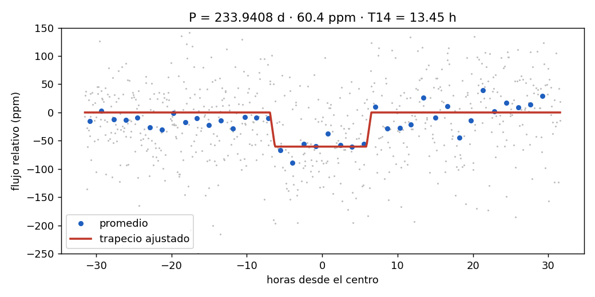
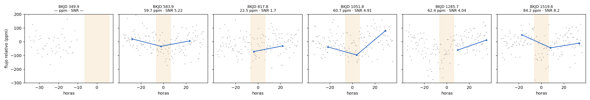
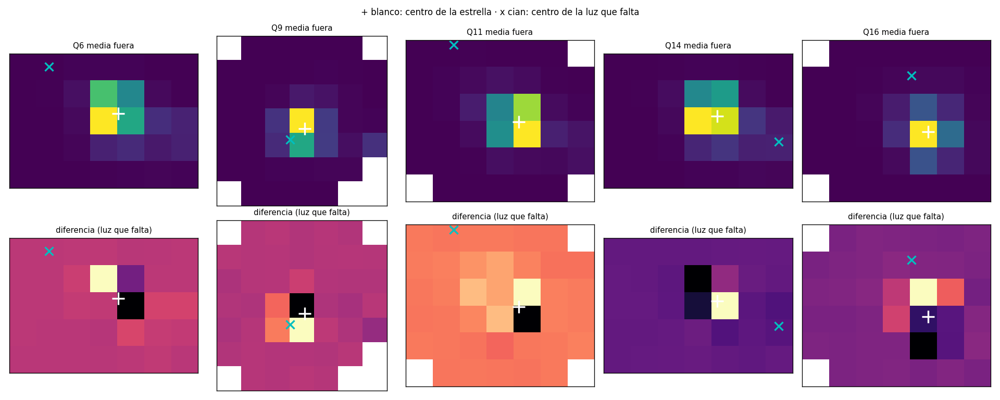

# KIC 6881353: candidato a tránsito de 234 días

**Estado: candidato débil, no confirmado.** Nada de lo que hay aquí confirma un planeta.
Autor: Javier Carrasco (Saka) · detectado con Sakanet (pipeline v2.2) · informe del 11 de noviembre de 2026 (versión 2: radio estelar corregido).

## Resumen

KIC 6881353 muestra una señal de tránsito de unos 60 ppm cada 233,94 días, compatible con un planeta de
unos 1,9 R⊕ (versión 1: 1,24 R⊕, con el radio estelar antiguo del KIC). No es KOI ni TCE de Kepler. Supera todas las pruebas que permiten los datos de Kepler. El riesgo
principal es una estrella de Gaia G = 17,4 a 2,65″: un eclipse del 1,1 % en ella imitaría la señal, y los
datos de Kepler no pueden descartarlo.

## La estrella

| Parámetro | Valor | Fuente |
| --- | --- | --- |
| Kepler magnitude (Kp) | 11,76 | KIC |
| Gaia DR3 | 2077172048372984192, G = 11,73, RUWE = 1,29 | Gaia DR3 |
| Temperatura | 6181 K | KIC |
| Radio | 2,29 R☉ | Gaia–Kepler (Berger et al. 2020); el KIC antiguo daba 1,46 R☉ |
| Comprobación del radio | 2,1–2,3 R☉ | paralaje Gaia DR3 (1,641 ± 0,017 mas, d ≈ 609 pc) + G y Teff, con A_G = 0–0,2 |
| Masa supuesta | 1,0–1,3 M☉ | subgigante F; no medida |
| Densidad | 0,08–0,11 ρ☉ | derivada |
| CDPP 6 h | 30,7 ppm | Kepler |

## La señal

| Parámetro | Valor |
| --- | --- |
| Período | 233,9408 d (otra pasada: 233,9498 d) |
| Época | BKJD 349,935 (BJD 2455182,935) |
| Profundidad | 60,4 ± 5,9 ppm |
| Duración T14 | 13,45 ± 0,66 h (central esperada: 24–26 h) |
| Ingreso | 0,65 h |
| SNR | 9,7–9,8 |
| Tránsitos con datos | 5: Q6, Q9, Q11, Q14 y Q16 (el de BKJD 349,9 cae en un hueco) |
| Radio del planeta | ≈ 1,9 ± 0,1 R⊕ |
| Parámetro de impacto | b ≈ 0,83–0,86 |
| Insolación | ≈ 10–13 S⊕ |
| Probabilidad RF / CNN | 0,57 / 0,44 |



## Pruebas

| Prueba | Resultado | Lectura |
| --- | --- | --- |
| Tránsitos pares / impares | 0,45 σ | sin diferencia |
| Eclipse secundario | SNR 0,05 | ninguno |
| Curva invertida (suelo de ruido) | señal 9,8 frente a 8,6 | por encima, con poco margen |
| Contribución máxima de un tránsito | 34 % | no depende de un solo evento |
| Jackknife | SNR mínimo 81 % | estable |
| Forma y duración | ingreso 0,65 h, b ≈ 0,85 | compatible con un planeta pequeño |
| Centroide de flujo | ≈ 0,6 σ | sin desplazamiento |
| Imagen diferencia | 3,2″ ± 3″ (0,7 σ) | sale de la estrella; excluye fuentes a más de ~10″ |

| Tránsito (BKJD) | Trimestre | Profundidad | SNR |
| --- | --- | --- | --- |
| 583,9 | Q6 | 60 ppm | 5,2 |
| 817,8 | Q9 | 23 ppm | 1,7 |
| 1051,8 | Q11 | 61 ppm | 4,9 |
| 1285,7 | Q14 | 62 ppm | 4,0 |
| 1519,6 | Q16 | 84 ppm | 8,2 |

El tránsito de Q9 es débil porque el flujo de alrededor también está bajo (entre −50 y −100 ppm).




Nota sobre `datos/analisis.json`: su sección de centroides se generó antes de corregir los errores (dice 3,68 σ).
Con los errores inflados por la dispersión entre eventos, el desplazamiento baja a unos 0,6 σ.

## Vecinos en Gaia DR3 (30″)

| Separación | G | ΔG | Eclipse necesario | ¿Descartada? |
| --- | --- | --- | --- | --- |
| 2,65″ | 17,42 | 5,69 | 1,1 % | **no** |
| 4,02″ | 20,23 | 8,50 | 15,2 % | no, poco probable |
| 4,09″ | 20,93 | 9,20 | 28,9 % | no, poco probable |
| 10,07″ | 19,49 | 7,76 | 7,7 % | al límite |
| 12,49″ | 18,43 | 6,70 | 2,9 % | casi (≈ 3 σ) |
| 12,89″ | 14,12 | 2,39 | 0,1 % | casi (≈ 3 σ) |
| 14,24″–20,49″ | 17,7–20,9 | — | 1,5–28 % | sí |

Eclipse necesario = 60 ppm × 10^(0,4·ΔG).

La vecina de 2,65″ está justo al sur del objetivo (ángulo de posición 182°). La imagen diferencia sitúa la luz que falta
hacia el este (+3,1″ E, +0,5″ N, ±3″), lejos de ella, pero sólo a ≈ 1,7 σ: la desfavorece sin descartarla.

## Conclusión y seguimiento

Candidato débil pero limpio. Con cinco tránsitos y SNR ≈ 10 sigue siendo posible un artefacto instrumental.
Para avanzar hace falta una imagen de alta resolución (óptica adaptativa o speckle) que descarte la vecina de 2,65″.

## Reproducir

Desde la raíz del repositorio, con el entorno de Sakanet:

```
python reanalizar_estrella.py 6881353      # detección con RF y CNN
python analisis_candidato.py               # tránsitos uno a uno, centroides y forma
python examen_pixeles.py                   # imagen diferencia y vecinos de Gaia
```

Datos: curvas PDCSAP y TPF de long cadence de Kepler (MAST), Gaia DR3.
