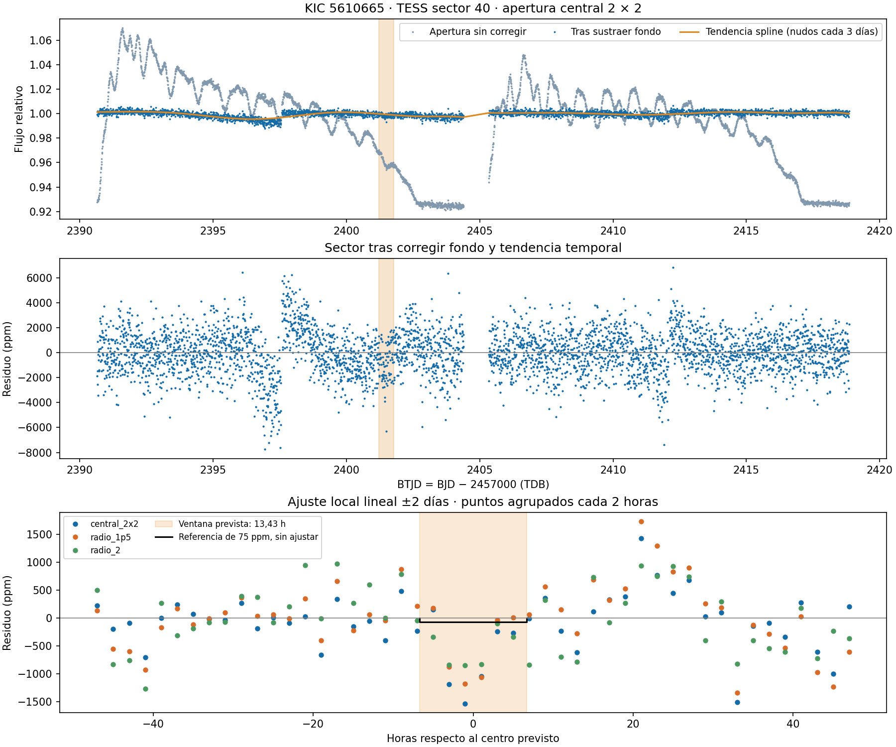
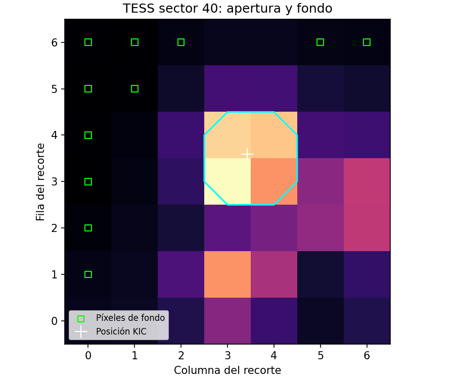

# Apéndice A. Extracción exploratoria TESS

[Volver al artículo](PAPER.md)

Esta extracción no tiene sensibilidad suficiente para detectar de manera robusta un único evento de 75 ppm. No proporciona una refutación de la hipótesis Kepler.

Se utiliza P = 215,39750429110552 días y t₀ = 260,54511369116005 BKJD. Para el ciclo n = 20:

`t_TESS = 2454833 + t₀ + 20 P − 2457000 = 2401,4952 BTJD (TDB)`.

La duración nominal es 13,4316 horas. No se dispone de incertidumbres y covarianza de P y t₀; la ventana extrapolada no incorpora el crecimiento de error tras veinte ciclos. La precisión decimal del cálculo no representa precisión física de la predicción.

Se emplean tres aperturas: cuadrado central 2×2 (4 píxeles), radio 1,5 (6 píxeles) y radio 2 (12 píxeles). El fondo se estima con la mediana de once píxeles del cuartil más débil de la imagen mediana, a más de 2,5 píxeles del objetivo. Puede contener luz estelar no resuelta. Se resta el fondo multiplicado por el área y se normaliza por la mediana del sector.

La tendencia global usa un spline cúbico con nodos separados 3 días y segmentos separados por huecos mayores de 0,5 días. Se protege ±0,65 días alrededor del centro y se aplica *clipping* iterativo de 5 MAD fuera de esa región. Las mediciones locales comparan polinomios de grados 1 y 2 con semiventanas de 2 y 3 días, excluyendo igualmente ±0,65 días. La profundidad es menos la media de los residuos relativos dentro de la duración nominal.

Las ventanas de control se desplazan 0,7 días y aplican la misma medición, evitando el evento protegido y huecos. Se solapan: su dispersión robusta es descriptiva, no una incertidumbre formal ni una probabilidad de falsa alarma. La elección de aperturas y tendencias es exploratoria, no un protocolo preregistrado. El código no utiliza FLUX_ERR para una inferencia probabilística.

La región protegida contiene 80 cadencias válidas. La configuración central, semiventana 2 días y grado 1 produce una profundidad de 623 ppm, dispersión de controles de 591 ppm y ruido robusto por cadencia de 1463 ppm. Incluso el cálculo idealizado 1463/√80 ≈ 164 ppm, que ignora ruido correlacionado e incertidumbre del fondo, supera los 75 ppm de Kepler.

| Apertura | Semiventana (d) | Grado | Profundidad (ppm) | Dispersión controles (ppm) |
|---|---:|---:|---:|---:|
| Central 2×2 | 2 | 1 | 623 | 591 |
| Central 2×2 | 2 | 2 | 948 | 583 |
| Central 2×2 | 3 | 1 | 516 | 974 |
| Central 2×2 | 3 | 2 | 727 | 901 |
| Radio 1,5 | 2 | 1 | 416 | 605 |
| Radio 1,5 | 2 | 2 | 1176 | 395 |
| Radio 1,5 | 3 | 1 | −382 | 605 |
| Radio 1,5 | 3 | 2 | 1258 | 814 |
| Radio 2 | 2 | 1 | 507 | 318 |
| Radio 2 | 2 | 2 | 1122 | 317 |
| Radio 2 | 3 | 1 | −241 | 555 |
| Radio 2 | 3 | 2 | 1333 | 262 |

Hay una depresión visual en algunas correcciones. Su amplitud y hasta el signo de la medición cambian con decisiones razonables de análisis. Las aperturas comparten píxeles, por lo que no constituyen confirmaciones independientes. No se atribuye de forma concluyente la variación a ruido, instrumental, estrella vecina o tránsito del objetivo. No se obtiene una detección robusta ni un límite superior formal.

**Figura A1.** Corrección exploratoria de tendencia y comparación local. La ventana nominal se obtiene extrapolando la efeméride Kepler sin incertidumbre propagada.

**Figura A2.** Geometría de las aperturas y píxeles utilizados para el fondo empírico.

## Sectores adicionales

TESScut devuelve los sectores 14, 40, 41, 54, 55, 74, 75, 80, 81 y 82 para estas coordenadas. La comparación con fechas de inicio y fin de HEASARC deja solo el sector 40 con un centro nominal dentro de su intervalo. El ciclo 25 cae aproximadamente 1,02 días antes de la fecha de inicio de sector 80. Esta comprobación usa fechas de calendario, no cobertura por cadencia de los otros sectores, y no propaga incertidumbre de efemérides. Los registros están en `data/catalog_checks/tess_sector_windows.csv`.
