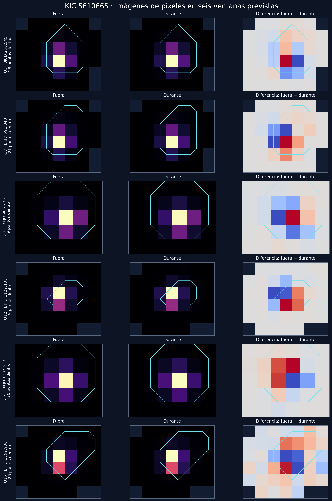
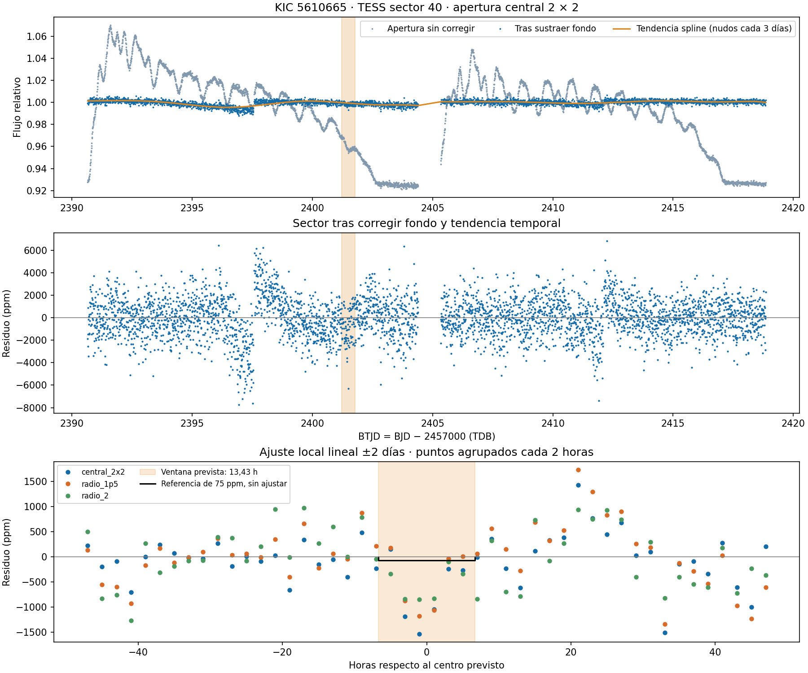
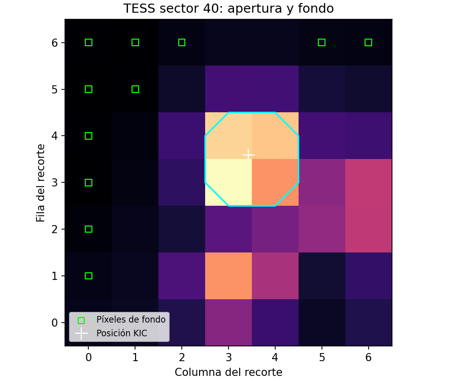

# Análisis exploratorio de señales de tránsito en KIC 5610665 con Sakanet y fotometría de TESS

**Autor: Javier Carrasco (Saka)**  
**Proyecto: Sakanet / Kepler Transit-Like Signal Pipeline**  
**Versión: borrador de investigación, 25 de septiembre de 2026. Sin revisión por pares.**

## Resumen

Se documentan cinco señales encontradas por Sakanet en curvas de Kepler de KIC 5610665 y una comprobación exploratoria con imágenes de TESS del sector 40. La señal de mayor prioridad presenta período de 215,397504 días, profundidad de 75,17 ppm, duración de 13,4316 horas y SNR de 10,03 según el archivo de resultados suministrado. Sus seis eventos tienen profundidades heterogéneas, incluyendo una negativa. Las puntuaciones RF y CNN comunicada posteriormente son 0,645 y 0,456; ninguna constituye una probabilidad calibrada de naturaleza planetaria. La extrapolación de la efeméride sitúa una ventana en el sector 40 de TESS, con 80 muestras válidas. La profundidad local depende fuertemente de la apertura y del modelo de tendencia: entre −382 y 1333 ppm en doce configuraciones. TESS no proporciona una corroboración robusta de la señal de 75 ppm. El trabajo conserva resultados originales, procedencia, análisis reproducible de TESS e imágenes exploratorias de Kepler. No establece un planeta, una probabilidad de planeta ni la novedad catalográfica de la señal.

**Palabras clave:** Kepler; TESS; fotometría; búsqueda de tránsitos; falsos positivos; KIC 5610665.

## 1. Objetivo y alcance

El objetivo es evaluar una señal débil localizada durante la búsqueda de Sakanet y registrar las comprobaciones disponibles para permitir su revisión. La identificación inicial y el desarrollo del proyecto corresponden a Javier Carrasco (Saka). La sesión del escáner corresponde al lote 23/175, con diez estrellas completadas y cero señales que alcanzaran el umbral de prioridad estricto.

Este estudio usa los resultados exportados del escáner; no reproduce de nuevo la búsqueda completa ni el entrenamiento de sus clasificadores. El autor comunicó una recuperación previa de 24 planetas conocidos. No se dispone aquí del listado y protocolo de esa prueba, por lo que no se utiliza como estimador de fiabilidad. El repositorio documenta además un benchmark ciego distinto sobre 123 señales KOI CANDIDATE; no debe confundirse con una muestra de planetas confirmados ni con la comprobación de este objetivo [1].

## 2. Datos y procedencia

Las coordenadas del encabezado Kepler son RA = 288,910601°, Dec = +40,800590°, con Kepler magnitude 12,12. Se conservan `candidates_original.csv`, `detections_original.csv` y una copia de los metadatos que elimina prefijos de rutas locales de Windows. Los números del escáner son resultados suministrados, no mediciones independientes de este manuscrito.

**Discrepancia de versiones:** los CSV originales no contienen una CNN disponible. Las cinco puntuaciones CNN posteriores proceden del informe textual del autor y se guardan por separado en `cnn_reported.csv`. Faltan el CSV actualizado, pesos, hashes y metadatos de aquella evaluación. No se han rellenado retroactivamente las columnas originales.

Los datos TESS utilizados son un recorte TESScut de 7×7 píxeles del sector 40, cámara 2, CCD 4 [2–4]. Contiene 3927 cadencias; 3917 pasan QUALITY = 0, tiempo finito y flujo finito en todos los píxeles. Su intervalo temporal es aproximadamente BTJD 2390,65847–2418,85320. Los productos originales grandes se referencian mediante URLs, tamaños y SHA256 en el manifiesto, siguiendo la convención de este repositorio de conservar las observaciones en archivos astronómicos. Los productos derivados y códigos se incluyen.

Se aportan también la tabla 2MASS suministrada y un archivo de imágenes IRSA Finder Chart. Son imágenes estáticas de contexto; no proporcionan fotometría temporal durante los eventos.

## 3. Métodos

### 3.1. Búsqueda Kepler y clasificación

Los metadatos indican PDCSAP_FLUX, máscara de calidad `default`, tiempos BKJD en TDB (BJD − 2454833), búsqueda entre 0,5 y 300 días, ventana de aplanado de 5 días, clipping 7, 30000 puntos gruesos, doce máximos refinados y cinco detecciones como máximo. La búsqueda se detuvo al alcanzar este último límite. Los detalles del BLS, refinamiento de duración, enmascarado iterativo y pruebas físicas se describen en el repositorio [1]. Las detecciones posteriores utilizan una curva con eventos anteriores enmascarados, lo que debe considerarse al interpretar las cinco señales conjuntamente.

RF y CNN clasifican etiquetas del conjunto de entrenamiento. No estiman directamente P(planeta | datos). La prioridad es una puntuación heurística distinta. No se calcula una tasa global de falsas alarmas de la búsqueda.

### 3.2. Imágenes Kepler dentro y fuera de las ventanas

Para seis centros nominales se comparan medianas de FLUX de los target pixel files con QUALITY = 0: dentro de media duración del centro y fuera entre 0,6 y 2 días a ambos lados. La imagen diferencial es mediana exterior menos mediana interior. Los ciclos 0, 2, 3, 4, 5 y 6 corresponden a los trimestres FITS Q3, Q7, Q10, Q12, Q14 y Q16. Los metadatos exportados señalan Q3, Q7, Q8, Q12, Q14 y Q15; esta discrepancia requiere auditar la asignación de etiquetas de segmento del escáner. No se ha determinado su causa.

Las imágenes usan escalas independientes por fila y no incluyen ajuste PRF, incertidumbres de centroide ni significancia de localización. La figura regenerada elimina una cruz de posición aproximada presente en una visualización anterior: no debe confundirse con una posición astrométrica calculada.

### 3.3. Efeméride extrapolada y extracción TESS

Se utiliza P = 215,39750429110552 días y t₀ = 260,54511369116005 BKJD. Para el ciclo n = 20:

`t_TESS = 2454833 + t₀ + 20 P − 2457000 = 2401,495199513156 BTJD (TDB)`.

La duración nominal es 13,4316 horas. No se dispone de incertidumbres y covarianza de P y t₀; la ventana extrapolada no incorpora el crecimiento de error tras veinte ciclos. La precisión decimal del cálculo no representa precisión física de la predicción.

Se emplean tres aperturas: cuadrado central 2×2 (4 píxeles), radio 1,5 (6 píxeles) y radio 2 (12 píxeles). El fondo se estima con la mediana de once píxeles del cuartil más débil de la imagen mediana, a más de 2,5 píxeles del objetivo. Puede contener luz estelar no resuelta. Se resta el fondo multiplicado por el área y se normaliza por la mediana del sector.

La tendencia global usa un spline cúbico con nodos separados 3 días y segmentos separados por huecos mayores de 0,5 días. Se protege ±0,65 días alrededor del centro y se aplica clipping iterativo de 5 MAD fuera de esa región. Las mediciones locales comparan polinomios de grados 1 y 2 con semiventanas de 2 y 3 días, excluyendo igualmente ±0,65 días. La profundidad es menos la media de los residuos relativos dentro de la duración nominal.

Las ventanas de control se desplazan 0,7 días y aplican la misma medición, evitando el evento protegido y huecos. Se solapan: su dispersión robusta es descriptiva, no una incertidumbre formal ni una probabilidad de falsa alarma. La elección de aperturas y tendencias es exploratoria, no un protocolo preregistrado. El código no utiliza FLUX_ERR para una inferencia probabilística.

## 4. Resultados

### 4.1. Cinco señales de Kepler

| Período (d) | Profundidad (ppm) | Duración (h) | SNR | RF | CNN comunicada | Prioridad | Interpretación del escáner |
|---:|---:|---:|---:|---:|---:|---:|---|
| 215,397504 | 75,17 | 13,4316 | 10,03 | 0,645 | 0,456 | 55,989 | Interesante; sin banderas automáticas |
| 264,930884 | 62,56 | 18,4860 | 8,07 | 0,496 | 0,498 | 32,591 | Baja confianza; duración en borde |
| 273,907844 | 63,19 | 22,1832 | 10,28 | 0,558 | 0,324 | 21,622 | Baja confianza; borde y dominio individual |
| 157,673813 | 43,19 | 22,1832 | 10,22 | 0,710 | 0,601 | 21,517 | Baja confianza; borde y dominio individual |
| 213,086786 | 61,02 | 19,7184 | 10,21 | 0,541 | 0,649 | 1,522 | Compatible con falso positivo según vetting |

La señal principal presenta seis eventos con profundidades 90,41; 79,89; −51,37; 75,44; 25,34 y 55,29 ppm; sus SNR individuales son 6,30; 5,16; −1,91; 2,81; 1,74 y 3,79. Por tanto, seis ventanas con datos no equivalen a seis detecciones individuales convincentes. La contribución máxima de un evento es 0,434 y la fracción mínima del SNR en jackknife es 0,752. La diferencia par/impar equivale a 1,78 sigma en la métrica exportada; la secundaria no es significativa. La ausencia de banderas no valida la hipótesis planetaria.

Para 213,09 días, las diferencias par/impar alcanzan 3,97 sigma y la secundaria en fase 0,5 tiene SNR 3,97. Son motivos de rechazo en este vetting; no establecen por sí solos una binaria física identificada. La CNN favorable no elimina estas alertas.

Se comunicaron métricas CNN sobre 251 ejemplos: accuracy 0,801, precisión 0,778, recall 0,862, F1 0,818, ROC-AUC 0,836 y average precision 0,791. No se aportó aquí el archivo de predicciones de prueba, y esas métricas no cuantifican la probabilidad planetaria de KIC 5610665.

**Figura 1.** Medianas de píxeles fuera y dentro de seis ventanas nominales, y su diferencia. Contorno cian: máscara de apertura del producto. Esta inspección no produce una localización fiable de una fuente eclipsante.

### 4.2. TESS sector 40

La región protegida contiene 80 cadencias válidas. La configuración central, semiventana 2 días y grado 1 produce una profundidad de 623 ppm, dispersión de controles de 591 ppm y ruido robusto por cadencia de 1463 ppm. Incluso el cálculo idealizado 1463/√80 ≈ 164 ppm, que ignora ruido correlacionado e incertidumbre del fondo, supera los 75 ppm de Kepler.

| Apertura | Semiventana (d) | Grado | Profundidad (ppm) | Dispersión controles (ppm) |
|---|---:|---:|---:|---:|
| Central 2×2 | 2 | 1 | 623 | 591 |
| Central 2×2 | 2 | 2 | 948 | 583 |
| Central 2×2 | 3 | 1 | 516 | 974 |
| Central 2×2 | 3 | 2 | 727 | 901 |
| Radio 1,5 | 2 | 1 | 416 | 605 |
| Radio 1,5 | 2 | 2 | 1176 | 395 |
| Radio 1,5 | 3 | 1 | −382 | 605 |
| Radio 1,5 | 3 | 2 | 1258 | 814 |
| Radio 2 | 2 | 1 | 507 | 318 |
| Radio 2 | 2 | 2 | 1122 | 317 |
| Radio 2 | 3 | 1 | −241 | 555 |
| Radio 2 | 3 | 2 | 1333 | 262 |

Hay una depresión visual en algunas correcciones. Su amplitud y hasta el signo de la medición cambian con decisiones razonables de análisis. Las aperturas comparten píxeles, por lo que no constituyen confirmaciones independientes. No se atribuye de forma concluyente la variación a ruido, instrumental, estrella vecina o tránsito del objetivo. No se obtiene una detección robusta ni un límite superior formal.

**Figura 2.** Corrección exploratoria de tendencia y comparación local. La ventana nominal se obtiene extrapolando la efeméride Kepler sin incertidumbre propagada.

**Figura 3.** Geometría de las aperturas y píxeles utilizados para el fondo empírico.

### 4.3. Catálogos e imágenes infrarrojas

La tabla 2MASS suministrada contiene la contraparte J19153854+4048021, con J = 10,956 ± 0,020, H = 10,653 ± 0,020 y Ks = 10,596 ± 0,018 mag, calidad AAA. El extracto WISE comunicado tiene `ph_qual=AAAU`, `moon_lev=0000`, detecciones W1 47/47, W2 47/47, W3 21/23 y W4 0/23, separación de consulta 0,441560 arcsec. No se dispone aquí de la tabla WISE completa. Estas propiedades ayudan a identificar la fuente y describir calidad fotométrica [5]; no son evidencia de tránsito. Las miniaturas IRAS de muy baja resolución no se utilizan cuantitativamente.

## 5. Discusión y comprobaciones pendientes

La etiqueta del escáner `completely unmatched signal` y los indicadores `known_koi=False`, `known_tce=False` describen su cruce local. No se conserva en este paquete una consulta exhaustiva, fechada y reproducible a todos los catálogos. En consecuencia, afirmaciones anteriores en la conversación de ausencia confirmada en KOI, TCE y planetas conocidos son demasiado fuertes. La novedad sigue sin establecerse. Los KOI son una categoría de selección de señales, distinta de la confirmación planetaria [6].

Tampoco se dispone de tablas Gaia y binarias vecinas que permitan verificar de manera reproducible las asociaciones mencionadas durante la conversación. Se requieren consultas por coordenadas, reconstrucción de aperturas por trimestre y comparación de efemérides con contaminantes. Los parámetros estelares aproximados discutidos (6050 K, 0,984 M☉, 1,128 R☉, 332 pc) carecen aquí de una tabla fuente verificada; no se utilizan para inferir un radio planetario ni habitabilidad.

Los pasos necesarios son: (1) reajustar los seis eventos Kepler con incertidumbres y ruido correlacionado; (2) auditar etiquetas de trimestre y sensibilidad a detrending/enmascarado; (3) realizar fotometría diferencial con PRF y centroides; (4) documentar cruces KOI/TCE/planetas y contaminantes; (5) propagar la incertidumbre de efemérides antes de buscar TESS; (6) comparar extracciones TESS independientes y aplicar inyección-recuperación y controles de falsas alarmas. El paquete actual no sustituye esas pruebas.

## 6. Conclusiones

La señal de 215,3975 días es una hipótesis de seguimiento con resultados heterogéneos entre eventos y clasificadores. Las otras cuatro señales presentan baja confianza o alertas de vetting. TESS sector 40 tiene cobertura de una ventana nominal, pero esta extracción no corrobora robustamente la señal débil Kepler. No se confirma un planeta, no se asigna una probabilidad física y no se demuestra que la señal sea inédita.

## Autoría, asistencia y disponibilidad

**Javier Carrasco (Saka)**: desarrollo de Sakanet, búsqueda inicial, aportación de resultados, planteamiento de las comprobaciones y autor del proyecto. Se utilizó asistencia de OpenAI ChatGPT/Codex para preparar código de análisis exploratorio, organizar datos y redactar este borrador. La IA no figura como autora. El manuscrito requiere revisión científica del autor antes de cualquier envío editorial. No se declara afiliación, financiación u ORCID no proporcionados.

El [README](README.md) describe archivos, reproducción y ausencias. La licencia del repositorio rige el código propio; las observaciones públicas y productos de terceros conservan sus condiciones originales. No se reivindica propiedad sobre datos de NASA/MAST o IRSA. No hay DOI ni publicación revisada por pares asociada a este borrador.

## Referencias

1. Carrasco, J. Sakanet / Kepler Transit-Like Signal Pipeline. [Repositorio, revisión usada como contexto de software](https://github.com/CarrascoOlmedoDevs/kepler-transit-like-pipeline/tree/3a90e7dab7ace48633a5deda34b85d797225347e). Esta revisión no demuestra qué commit produjo los CSV originales.
2. MAST. [TESScut: documentación y API](https://mast.stsci.edu/tesscut/docs/getting_started.html).
3. NASA HEASARC. [Productos de datos TESS](https://heasarc.gsfc.nasa.gov/docs/tess/data-products.html).
4. TESS Science Office. [Sector 40](https://tess.mit.edu/observations/sector-40/).
5. IRSA. [AllWISE Source Catalog: descripción de columnas](https://irsa.ipac.caltech.edu/data/WISE/docs/release/AllWISE/expsup/sec2_1a.html).
6. NASA Exoplanet Archive. [Documentación KOI](https://exoplanetarchive.ipac.caltech.edu/docs/Kepler_KOI_docs.html).
