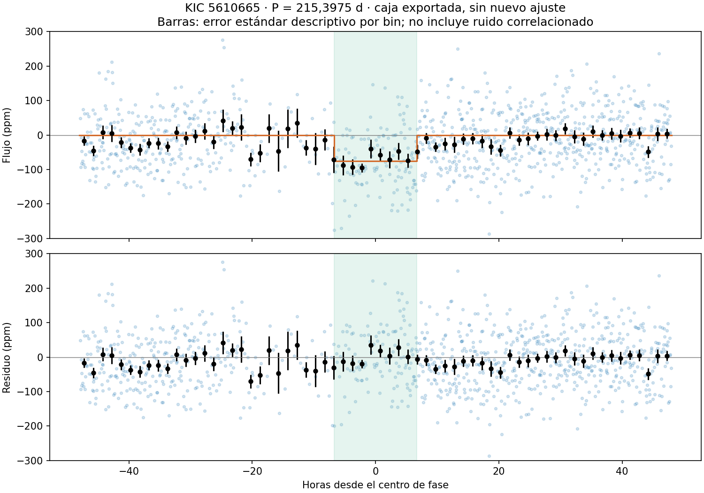
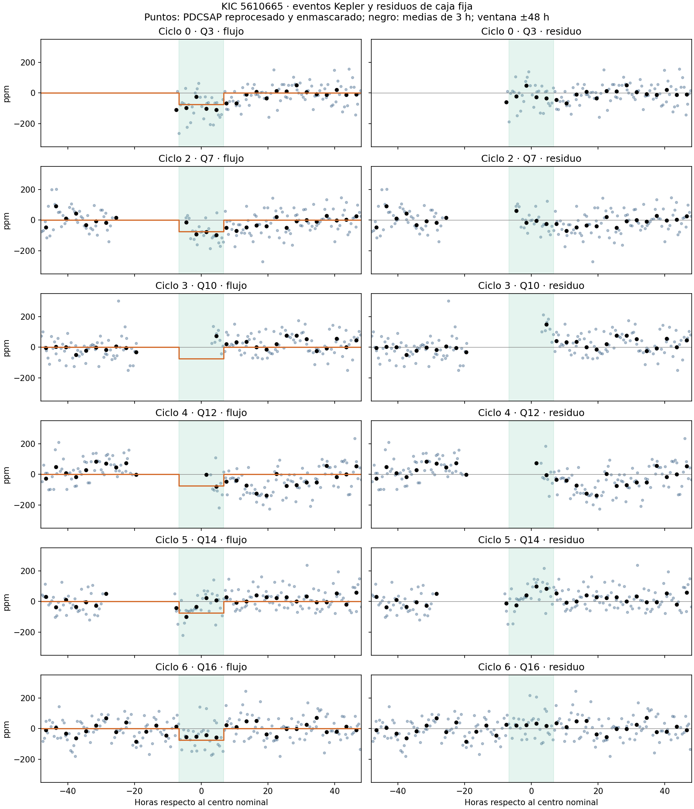
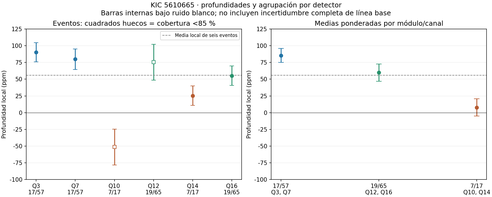

# Cobertura temporal y fiabilidad de una señal de 215,4 días en KIC 5610665

**Javier Carrasco (Saka)**  
**Sakanet / Kepler Transit-Like Signal Pipeline**  
**Borrador revisado: 26 de septiembre de 2026. Sin revisión por pares.**

## Resumen

Se investiga una señal de tránsito encontrada por Sakanet en la fotometría Kepler de KIC 5610665. La reconstrucción de las 18 curvas Q0–Q17 reproduce cinco detecciones del análisis original. La señal de mayor prioridad tiene período de 215,3975 días, profundidad de 75,17 ± 7,50 ppm y duración de 13,4316 horas; la incertidumbre es interna al estimador y no incorpora ruido correlacionado ni selección entre múltiples períodos. Se presentan la curva plegada, los seis eventos con datos y una auditoría de cobertura. Dos ventanas conservan solo el 29 % y 31 % de la duración nominal; los dos eventos más fuertes aportan el 72,4 % del peso positivo del diagnóstico de consistencia. Los cuatro eventos de mayor cobertura son inconsistentes con profundidad constante bajo los errores internos de ruido blanco (χ² = 11,76 para 3 grados de libertad; p nominal = 0,0082). La agrupación por módulo muestra profundidades diferentes, pero la dilución estimada en las cabeceras no explica esa diferencia. Las señales de 215,40 y 213,09 días no comparten cadencias de tránsito. Cinco de ocho reordenaciones de trimestres producen detecciones de SNR comparable o mayor, pero ninguna de esas detecciones carece de alertas de vetting; la inversión no produce detecciones aceptadas. Las consultas archivadas no encuentran coincidencias por KIC en KOI acumulativa, TCE DR25 o nombres Kepler confirmados. TESS sector 40 carece de sensibilidad suficiente en esta extracción para comprobar un único evento de 75 ppm. La señal requiere una evaluación del ruido correlacionado y de su localización antes de atribuirle una naturaleza planetaria.

**Palabras clave:** Kepler; tránsitos; ruido instrumental; TESS; KIC 5610665.

## 1. Introducción

Las búsquedas de tránsitos débiles y de período largo pueden combinar fluctuaciones, bordes de observación y eventos parciales en máximos de aparente significancia. KIC 5610665 fue identificada durante el lote 23/175 de Sakanet, que finalizó sin señales que cumplieran el filtro estricto de prioridad. Este trabajo examina la señal de 215,4 días mediante reconstrucción de la fotometría, inspección individual de sus eventos y controles de búsqueda.

El desarrollo de Sakanet y la identificación inicial corresponden a Javier Carrasco (Saka). El estudio es específico de este objetivo; no evalúa la fiabilidad poblacional del programa. El *benchmark* documentado en el repositorio constituye un experimento distinto [1].

## 2. Observaciones y métodos

### 2.1. Fotometría Kepler y reconstrucción

El objetivo tiene RA = 288,910601°, Dec = +40,800590° y magnitud Kepler Kp = 12,12. Se descargaron los 18 productos de cadencia larga indicados en los metadatos originales. Se normaliza PDCSAP_FLUX por la mediana de cada producto y se aplica la máscara `default` de Lightkurve, equivalente a 1130799 [7]. Los tiempos se expresan en BKJD = BJD(TDB) − 2454833.

Se utilizaron sin cambios las funciones de preprocesamiento, BLS y extracción del código de referencia [1]: mediana móvil de 5 días, separación en bordes de producto y huecos >0,5 días, *clipping* superior de 7 veces el ruido, búsqueda entre 0,5 y 300 días, 30000 períodos gruesos, doce máximos refinados y hasta cinco detecciones. La reconstrucción conserva 65263 puntos antes del preprocesamiento y 65232 después. Antes de la quinta detección quedan 63181 puntos tras enmascarar las cuatro anteriores. Las profundidades y SNR de las cinco efemérides exportadas se reproducen con discrepancias inferiores a 10⁻⁸ ppm y 10⁻⁸, respectivamente.

Los CSV originales se conservan. La CNN no está disponible en esos archivos: sus valores posteriores, comunicados por el autor, se guardan en una tabla separada. RF, CNN y prioridad son diagnósticos de clasificación o selección, no probabilidades físicas calibradas.

### 2.2. Eventos, cobertura y residuos

Se adopta la efeméride exportada, P = 215,39750429110552 días, t₀ = 260,54511369116005 BKJD y D = 13,4316 h. Las figuras muestran una caja fija con estos parámetros y profundidad 75,17 ppm; no se presenta como un nuevo ajuste físico con oscurecimiento al limbo. Cada evento se representa dentro de ±48 h, restando la misma línea base local usada por el diagnóstico de consistencia. En el plegado se resta una mediana exterior global. Las barras por bin son errores estándar descriptivos.

La cobertura se calcula como la suma del solapamiento de los intervalos de cadencia válida con la ventana nominal, dividida por D. Los bordes de segmento se definen en la fotometría finita tras la máscara de calidad, al cambiar de producto o superar un hueco de 0,5 días. Se informa la distancia absoluta del centro al borde más cercano y si el centro queda dentro de un segmento. La cifra no es una significancia de asociación con bordes.

### 2.3. Controles empíricos de búsqueda

Se ejecuta la búsqueda nominal, una inversión `f → 2 − f` de la curva normalizada antes del preprocesamiento y ocho reordenaciones completas de trimestres con semillas 42–49. Las reordenaciones preservan muestras, errores y huecos internos de cada trimestre; concatenan los bloques permutados usando la secuencia original de huecos entre trimestres. Por tanto, alteran la función de ventana y no prueban intercambiabilidad estadística.

Cada realización conserva la configuración original, el criterio de parada y el enmascarado adaptativo, con hasta cinco detecciones. Se registra el mayor SNR entre las detecciones aceptadas de 150–300 días y se compara con 10,0281. No se aplican RF/CNN porque sus pesos no están disponibles; el ensayo prueba el núcleo de búsqueda y medida, no la selección final completa.

La inversión y el reordenamiento están motivados por los controles de fiabilidad de Kepler DR25 [8], pero esta implementación no reproduce su protocolo: DR25 preservó estructura estacional mediante bloques anuales en el reordenamiento descrito. Ocho permutaciones de una sola estrella son una prueba exploratoria, no una tasa calibrada de falsas alarmas ni una probabilidad planetaria. Los bloques conservan posibles tránsitos reales que pueden volver a alinearse. Tras la comparación de SNR se aplica además el vetting determinista a todas las detecciones aceptadas, reconstruyéndolas sin repetir BLS; se informa esta comparación complementaria por separado.

## 3. Resultados Kepler

### 3.1. Señal plegada y eventos individuales

La profundidad global es 75,17 ± 7,50 ppm, con SNR = 10,03. El error se obtiene del mismo estimador que define el SNR e incluye su error de línea base; no representa la incertidumbre total de una señal seleccionada mediante búsqueda. La heterogeneidad de los eventos exige examinarla separadamente.

**Figura 1.** Fotometría Kepler reconstruida y enmascarada, plegada a 215,3975 días. Caja naranja: modelo exportado fijo. Panel inferior: residuos. Puntos negros y barras: medias de 1,5 h y errores estándar; no modelan correlaciones temporales.

**Figura 2.** Los seis eventos observados, con idénticas escalas; puntos negros: medias de 3 h. La ventana verde marca la duración nominal. La caja tiene los mismos parámetros en todos los paneles. En Q3 falta contexto anterior al evento; Q10 y Q12 tienen cobertura parcial. Los puntos fuera de la ventana pueden pertenecer al trimestre adyacente.

| Ciclo | Centro BKJD | Q | Módulo/canal | Puntos válidos | Cobertura | Borde más cercano (h) | Centro en segmento | Profundidad local ± error interno (ppm) |
|---:|---:|---:|---|---:|---:|---:|---|---:|
| 0 | 260,5451 | 3 | 17/57 | 28 | 100,0 % | 7,44 | Sí | 90,41 ± 14,34 |
| 1 | 475,9426 | 5 | 9/25 | 0 | 0,0 % | 8,03 | No | — |
| 2 | 691,3401 | 7 | 17/57 | 24 | 86,5 % | 4,90 | Sí | 79,89 ± 15,49 |
| 3 | 906,7376 | 10 | 7/17 | 8 | 28,7 % | 2,85 | No | -51,37 ± 26,83 |
| 4 | 1122,1351 | 12 | 19/65 | 8 | 30,8 % | 2,57 | No | 75,44 ± 26,83 |
| 5 | 1337,5326 | 14 | 7/17 | 27 | 96,4 % | 8,25 | Sí | 25,34 ± 14,60 |
| 6 | 1552,9301 | 16 | 19/65 | 27 | 100,0 % | 120,94 | Sí | 55,29 ± 14,60 |

Los errores locales son cocientes profundidad/SNR del diagnóstico, cuyo ruido supone muestras independientes y no incorpora incertidumbre de la mediana local. Un ruido doble no implica por sí mismo la mitad de observaciones: bajo ruido blanco constante correspondería a una cuarta parte. Aquí la cobertura se ha medido directamente.

El ciclo 1 está dentro del intervalo de Q5, módulo 9/canal 25, pero su ventana cae en un hueco sin cadencias. No es ausencia del trimestre por el módulo 3. El centro del ciclo 3 precede el primer tiempo registrado de Q10 en 2,61 h; solo quedan ocho muestras de PDCSAP válidas dentro de la ventana. En Q12, de 27 posiciones temporales dentro de la ventana, ocho superan la selección de fotometría finita y calidad; aparecen banderas de exclusión manual, entre otras. Q3 comienza muy cerca del ingreso nominal, lo que también limita la estimación de línea base.

Los ciclos 0 y 2 aportan el 72,4 % de Σmax(SNRᵢ,0)², la definición positiva empleada por Sakanet; usando cuadrados con ambos signos aportan el 69,6 %. Al excluir sus ventanas locales, la medida global a efeméride fija queda en 55,62 ± 10,00 ppm (SNR = 5,56). Al excluir solo los dos eventos parciales, queda en 82,67 ± 7,68 ppm (SNR = 10,77). Estas pruebas posteriores a la selección muestran dependencia de los eventos y no constituyen confirmaciones independientes.

La discrepancia de trimestres del CSV está explicada por el código: `transit_consistency` exporta los índices de `curve.segment` como `quarters_with_transits`. Al traducirlos mediante la lista de productos, [3,7,8,12,14,15] corresponde a Q3, Q7, Q10, Q12, Q14 y Q16. Los tiempos y flujos se reconstruyen correctamente; el problema identificado es la etiqueta del trimestre.

### 3.1.1. Consistencia de profundidades

Con σᵢ = |profundidadᵢ/SNRᵢ| se calcula la media ponderada μ = Σ(dᵢ/σᵢ²)/Σ(1/σᵢ²) y χ² = Σ[(dᵢ − μ)/σᵢ]², con n−1 grados de libertad. Para los seis eventos, μ = 55,89 ± 6,87 ppm y χ² = 29,08 para 5 grados de libertad (p nominal = 2,23×10⁻⁵). Para Q3, Q7, Q14 y Q16, con cobertura ≥85 %, μ = 62,51 ± 7,37 ppm y χ² = 11,76 para 3 grados de libertad (p nominal = 0,0082). Se denominan eventos de mayor cobertura: Q7 conserva el 86,5 %, no una ventana completa. La media de profundidades locales no es el estimador global de 75,17 ppm: cambian las líneas base y los pesos.

Estas pruebas suponen errores gaussianos independientes, efeméride fija y ausencia de variación de profundidad; no incorporan selección de señal, incertidumbre de línea base, ruido correlacionado ni el muestreo de una morfología física en eventos parciales. Son diagnósticos nominales de inconsistencia, no probabilidades planetarias. Multiplicar todos los errores por aproximadamente 1,98 en el conjunto de cuatro eventos llevaría χ² reducido a uno; esto ilustra sensibilidad a errores subestimados, no mide ni corrige el ruido correlacionado.

Q14 tiene 25,34 ± 14,60 ppm con el 96,4 % de cobertura. Frente a la media de los otros tres eventos de mayor cobertura, 75,21 ± 8,54 ppm, la diferencia equivale a 2,95σ al combinar ambos errores bajo independencia. El valor de 3,4σ frente a 75 ppm omite la incertidumbre de la referencia; la profundidad global además comparte datos con Q14. Retirar Q10 y Q12 aumenta el SNR global a 10,77: los eventos parciales no inflan esa medida, pero persiste la inconsistencia entre los restantes.

### 3.1.2. Agrupación por detector y métricas de apertura

Se extrajeron `CROWDSAP` y `FLFRCSAP` de las cabeceras de las 18 curvas originales. La tabla agrupa los eventos por módulo/canal; las parejas de métricas siguen el orden de los trimestres.

| Módulo/canal | Trimestres | Media local ponderada (ppm) | CROWDSAP | FLFRCSAP |
|---|---|---:|---|---|
| 17/57 | Q3, Q7 | 85,56 ± 10,52 | 1,0000; 1,0000 | 0,9522; 0,9630 |
| 19/65 | Q12, Q16 | 59,89 ± 12,83 | 1,0000; 1,0000 | 0,8603; 0,9632 |
| 7/17 | Q10, Q14 | 7,81 ± 12,83 | 0,9995; 0,9995 | 0,9853; 0,9852 |
| 9/25 | Q5 | Sin cadencias en la ventana | 1,0000 | 0,9736 |

`CROWDSAP` estima la fracción del flujo de la apertura atribuida al objetivo; `FLFRCSAP` estima la fracción del flujo del objetivo capturada. PDC aplica las correcciones de contaminación y pérdida de flujo [14]; no se divide PDCSAP de nuevo por estas métricas. La diferencia de CROWDSAP entre 17/57 y 7/17 es solo 0,0005: incluso antes de la corrección, la dilución modelada de un tránsito del objetivo de 75 ppm cambiaría su profundidad en aproximadamente 0,038 ppm, muy por debajo de las diferencias observadas. FLFRCSAP no es una fracción de contaminación.

**Figura 3.** Profundidades locales y medias ponderadas por módulo/canal. Cuadrados huecos: ventanas con cobertura <85 %. Línea discontinua: media local de los seis eventos. Las barras son errores internos bajo ruido blanco.

Los dos eventos más fuertes comparten 17/57 y los más débiles 7/17. La agrupación es exploratoria, con solo dos eventos por módulo y confundida con época, bordes y cobertura; incluso Q10 y Q14 difieren entre sí. Las cabeceras no respaldan una explicación mediante la dilución estimada del objetivo, pero tampoco excluyen una fuente variable tenue no modelada ni una sistemática de canal. No se ha localizado el origen de la señal. Q7, uno de los eventos dominantes, tiene además el mayor RB_LEVEL a la duración de prueba de 24 cadencias (0,554; sección 3.3).

### 3.2. Relación entre las cinco detecciones

| Período (d) | Profundidad (ppm) | Duración (h) | SNR | RF | CNN comunicada | Prioridad | Alertas principales |
|---:|---:|---:|---:|---:|---:|---:|---|
| 215,397504 | 75,17 | 13,4316 | 10,03 | 0,645 | 0,456 | 55,989 | Sin alertas automáticas; eventos heterogéneos |
| 264,930884 | 62,56 | 18,4860 | 8,07 | 0,496 | 0,498 | 32,591 | Borde de duración |
| 273,907844 | 63,19 | 22,1832 | 10,28 | 0,558 | 0,324 | 21,622 | Borde y dominio individual |
| 157,673813 | 43,19 | 22,1832 | 10,22 | 0,710 | 0,601 | 21,517 | Borde y dominio individual |
| 213,086786 | 61,02 | 19,7184 | 10,21 | 0,541 | 0,649 | 1,522 | Par/impar y secundaria |

La separación relativa entre 215,40 y 213,09 días es 1,073 %. No hay solapamiento de cadencias dentro de las ventanas primarias, ni entre la principal y la secundaria nominal de 213 días; tampoco elimina puntos de tránsito principal el enmascarado de la primera detección con el ancho exportado. La secundaria más cercana queda a 2,28 días de uno de los centros de la señal principal. No se trasladan automáticamente las alertas par/impar y secundaria (ambas ≈3,97 sigma) de una señal a la otra. Esto no descarta una sistemática común de escala más amplia.

Las duraciones repetidas de 22,1832 h y las banderas de borde en tres señales aconsejan estudiar el conjunto como posibles máximos anchos sensibles al aplanado. En el código, la bandera de borde persiste si se tocó un límite intermedio, incluso tras expandir y refinar la rejilla: no demuestra que 22,1832 h sea el límite final. Este patrón es compatible con problemas de búsqueda o variabilidad de baja frecuencia, sin identificar por sí solo su origen.

### 3.3. Calidad y rolling band

Se inspeccionaron QUALITY y RB_LEVEL de los TPF en las siete ventanas, incluida la vacía. En las cadencias presentes no se activan los bits de *rolling band* en apertura ni máscara (131072 y 262144), que no forman parte de `default` [7]. RB_LEVEL expresa amplitud respecto al umbral de detección del artefacto; uno es la referencia de umbral [9]. Las cinco duraciones RBTDUR están en cadencias largas, no horas, según la errata oficial aplicable a Kepler DR25 [15].

Para 24 cadencias (≈11,77 h, la prueba más cercana a la duración de 13,43 h), los máximos en filas de apertura de Q3/Q7/Q10/Q12/Q14/Q16 son 0,332/0,554/0,168/0,309/0,383/0,457. Q7 tiene el máximo a esta duración y es uno de los dos eventos dominantes. Estos seis valores son inferiores a uno, pero no todos los valores de la auditoría lo son: a tres cadencias los máximos van de 1,261 a 1,509 y a seis cadencias Q3 y Q14 también superan uno. La documentación advierte que los bits binarios no son un indicador fiable por sí solos [15]. Las escalas cortas no demuestran que el artefacto origine la señal de 13 h; tampoco la ausencia de bits demuestra una curva libre de sistemáticas. La [tabla propia completa](data/kepler_review/rolling_band.csv) conserva las cinco duraciones.

### 3.4. Controles de inversión y reordenación

La búsqueda nominal reproduce las cinco detecciones, en orden, con los mismos períodos y duraciones y SNR coincidentes dentro de 10⁻⁷. La curva invertida se detiene en la primera iteración sin detecciones aceptadas por el criterio original. En **5 de las ocho reordenaciones** aparece al menos una detección de 150–300 días con SNR ≥ 10,0281. El máximo alcanza 11,55. Estos resultados muestran que un SNR ≈10 no es excepcional bajo este reordenamiento.

La comparación complementaria con vetting cambia la lectura: **0 de ocho** reordenaciones produce una detección de ese rango y SNR sin banderas. Todas las que superan el umbral tienen al menos una alerta, incluida la de duración en borde. Por tanto, el ensayo reproduce SNR similares pero no todas las propiedades de la señal principal, que carece de esas banderas automáticas. Los RF/CNN no fueron aplicados. El cociente 5/8 no es una FAP y 0/8 no demuestra ausencia de falsas alarmas.

| Realización | Semilla | Detecciones aceptadas, todos los períodos | Máximo SNR 150–300 d | Número ≥10,0281 | De ellas sin banderas |
|---|---:|---:|---:|---:|---:|
| Nominal | — | 5 | 10,276 | 4 | 1 |
| Invertida | — | 0 | — | 0 | 0 |
| Reordenada | 42 | 3 | 10,439 | 2 | 0 |
| Reordenada | 43 | 4 | 11,422 | 3 | 0 |
| Reordenada | 44 | 2 | 11,548 | 1 | 0 |
| Reordenada | 45 | 4 | 9,450 | 0 | 0 |
| Reordenada | 46 | 0 | — | 0 | 0 |
| Reordenada | 47 | 4 | 9,120 | 0 | 0 |
| Reordenada | 48 | 2 | 10,581 | 1 | 0 |
| Reordenada | 49 | 3 | 10,275 | 1 | 0 |

Bajo un modelo hipotético de ocho ensayos Bernoulli independientes con tasa común, cero éxitos daría una cota superior unilateral del 95 % de 1−0,05^(1/8) = 31,2 %. El extremo superior del intervalo bilateral de colas iguales del 95 % sería 36,9 %. La primera cifra es la cota unilateral, no una FAP medida: no se ha validado ese modelo como representación de las falsas alarmas astronómicas de esta estrella.

Las ocho detecciones reordenadas que satisfacen período y SNR tienen alerta de duración en borde; siete tienen además otras alertas. Los recuentos, no excluyentes, son dominio individual (5), par/impar (5), preferencia por período doble (3), secundaria (1) y anomalía en fase 0,5 (1). Solo una falla exclusivamente por duración. Incluyendo la curva nominal, hay doce detecciones en ese rango y umbral: once con alertas y una sin ellas. No son ensayos independientes ni once falsos positivos confirmados. El [Apéndice B](APENDICE_CONTROLES.md) enumera las alertas concretas de las 27 detecciones aceptadas, incluidas las de menor SNR.

El guion en la columna de SNR indica ausencia de detecciones aceptadas en el intervalo, no un SNR medido igual a cero. Se conservan todas las realizaciones y sus motivos de parada en `data/null_controls`.

### 3.5. Coherencia de la duración

La consulta `keplerstellar`, entrega `q1_q17_dr25_stellar`, devuelve M⋆ = 0,984 (+0,142/−0,116) M☉, R⋆ = 1,128 (+0,242/−0,198) R☉ y T_eff = 6050 K [10]. Para un planeta pequeño, órbita circular y tránsito central, `T ≈ (P/π) asin(R⋆/a)` con `a³ = GM⋆P²/(4π²)` da 12,34 h. Las 13,43 h de la caja BLS son compatibles a este nivel con la incertidumbre estelar y las diferencias entre caja y duración física. La estimación no mide el parámetro de impacto, excentricidad o radio planetario; falta un ajuste físico y propagación de covarianzas.

## 4. Información complementaria

### 4.1. Sensibilidad de TESS

**Esta extracción del sector 40 no tiene sensibilidad suficiente para comprobar un único tránsito de 75 ppm.** La ventana nominal de 13,43 h contiene 80 cadencias; con ruido robusto de 1463 ppm por cadencia, el error idealizado de una media sería ≈164 ppm, incluso antes de incluir correlaciones y errores de línea base. Esta limitación no se generaliza a toda reducción posible ni a la combinación de muchos eventos TESS.

La efeméride extrapolada al ciclo 20 sitúa el centro en BTJD(TDB) = 2401,4952. No hay incertidumbre estimada de período/época; un supuesto error de período de 0,01 días produciría por sí solo una deriva de 4,8 h tras veinte ciclos. Esta cifra ilustra sensibilidad y no estima el error real.

Las doce extracciones exploratorias producen profundidades entre −382 y 1333 ppm. Su escala y dependencia de tendencia/apertura impiden interpretarlas como la señal Kepler. Una dilución adicional del objetivo tendería a reducir, no aumentar, la profundidad, aunque las bandas espectrales y un contaminante pueden cambiar la comparación. No se ha establecido cuál de esas contribuciones domina. Los métodos, tabla completa, figuras y revisión de otros sectores se trasladan al [Apéndice A](APENDICE_TESS.md). Solo el sector 40 contiene un centro nominal dentro de las fechas de los diez sectores identificados por TESScut; los demás no se han examinado por cadencia [2–4,11].

### 4.2. Catálogos y localización

Consultas por `kepid=5610665`, guardadas con fecha UTC, consulta y SHA256, devuelven cero filas en `cumulative`, `q1_q17_dr25_tce` y `keplernames`. Se consultaron el 25 de septiembre de 2026 UTC (26 de septiembre en España). Esto establece ausencia de coincidencia por ese identificador en esas tablas y fecha; no una búsqueda exhaustiva de literatura, alias o contaminación por vecinos [6,12].

El pipeline oficial exigía MES ≥7,1 y al menos tres tránsitos, además de pruebas adicionales [8]. El MES de Kepler y el SNR de profundidad/error de Sakanet son estadísticos distintos. La ausencia en TCE DR25 documenta falta de recuperación catalogada independiente; sin calibrar recuperación, procesamiento y selección no cuantifica cuánto pesa contra esta señal ni contradice por sí sola el SNR de Sakanet.

La copia histórica FPWG de junio de 2016 alojada en MAST contiene 599 filas y ninguna coincidencia por `Kepler_Id=5610665`. Es un producto relacionado con DR24, no una comprobación de la tabla FPWG actual [13]. El intento de consultar `fpwg` mediante la API antigua fue rechazado como tabla inválida y se conserva como intento fallido, no como resultado vacío.

Las imágenes diferenciales Kepler disponibles no incluyen un ajuste PRF con incertidumbres de centroide. Se conservan en el [material complementario](figures/kepler_pixels.png). Las imágenes estáticas IRSA y la contraparte 2MASS apoyan la identificación estelar, no una detección de tránsito. Las métricas fotométricas de la contraparte AllWISE describen la calidad de su fotometría infrarroja [5], no la significancia de la señal periódica Kepler. No se ha completado una exclusión de fuentes vecinas.

## 5. Discusión y conclusión

El resultado cuantitativo más adverso es la inconsistencia de profundidades bajo el modelo de errores internos, presente también entre los cuatro eventos de mayor cobertura. La agrupación por módulo motiva investigar sistemáticas y contaminación, pero CROWDSAP no respalda una diferencia suficiente de dilución modelada. Estas observaciones debilitan la interpretación de profundidad constante sin identificar una causa alternativa. El valor del SNR global queda limitado por la selección entre períodos, correlaciones temporales, cobertura parcial y proximidad de eventos a bordes. Los dos eventos más fuertes dominan el diagnóstico local, aunque al retirarlos permanece una depresión global más débil a la efeméride fijada. Los controles muestran que el SNR aislado no discrimina suficientemente; no reproducen una detección comparable sin alertas, pero su pequeño número y reordenamiento no estacional impiden cuantificar la fiabilidad. La coherencia aproximada de duración y la ausencia de coincidencia en tres tablas son información útil, pero no resuelven la naturaleza de la señal.

Los siguientes análisis deben estimar una efeméride y profundidad con ruido correlacionado, comparar aplanados que protejan los eventos y cuantificar el efecto de bordes con inyección-recuperación. También se requiere localizar la fuente mediante imágenes diferenciales y PRF, contrastar vecinos y ampliar controles con un protocolo estacional y población adecuada. El presente trabajo documenta una señal de seguimiento, sin confirmar un planeta ni asignarle una probabilidad física.

## Autoría y disponibilidad

**Javier Carrasco (Saka)**: desarrollo de Sakanet, identificación inicial, aportación de resultados y planteamiento de las comprobaciones. Se utilizó asistencia de OpenAI ChatGPT/Codex para programación de análisis exploratorios, organización de datos y redacción. La IA no figura como autora. Este borrador requiere revisión científica del autor antes de un envío editorial.

Los archivos, procedimientos y registros están descritos en el [README](README.md). Los resultados CNN posteriores son datos comunicados, con *accuracy* 0,801, precisión 0,778, *recall* 0,862, F1 0,818, ROC-AUC 0,836 y *average precision* 0,791 sobre 251 ejemplos, sin pesos ni predicciones de prueba aportados aquí. Se conserva ese límite de procedencia. Las observaciones NASA/MAST e IRSA mantienen sus condiciones de uso; el código propio está sujeto a la licencia del repositorio. Se agradece el uso de NASA Exoplanet Archive, incluyendo sus datos estelares (DOI 10.26133/NEA6).

## Referencias

1. Carrasco, J. Sakanet / Kepler Transit-Like Signal Pipeline. [Repositorio, revisión usada como contexto de software](https://github.com/CarrascoOlmedoDevs/kepler-transit-like-pipeline/tree/3a90e7dab7ace48633a5deda34b85d797225347e). Esta revisión no demuestra qué commit produjo los CSV originales.
2. MAST. [TESScut: documentación y API](https://mast.stsci.edu/tesscut/docs/getting_started.html).
3. NASA HEASARC. [Productos de datos TESS](https://heasarc.gsfc.nasa.gov/docs/tess/data-products.html).
4. TESS Science Office. [Sector 40](https://tess.mit.edu/observations/sector-40/).
5. IRSA. [AllWISE Source Catalog: descripción de columnas](https://irsa.ipac.caltech.edu/data/WISE/docs/release/AllWISE/expsup/sec2_1a.html).
6. NASA Exoplanet Archive. [Documentación KOI](https://exoplanetarchive.ipac.caltech.edu/docs/Kepler_KOI_docs.html).

7. Lightkurve. [KeplerQualityFlags y máscaras de calidad](https://lightkurve.github.io/lightkurve/_modules/lightkurve/utils.html).
8. Thompson, S. E., et al. (2018). *Planetary Candidates Observed by Kepler. VIII*. ApJS, 235, 38. [Artículo](https://arxiv.org/abs/1710.06758).
9. Kepler. [Notas de la entrega DR25](https://ntrs.nasa.gov/api/citations/20170008455/downloads/20170008455.pdf).
10. NASA Exoplanet Archive. [Columnas de Kepler Stellar](https://exoplanetarchive.ipac.caltech.edu/docs/API_keplerstellar_columns.html).
11. NASA HEASARC. [Fechas de sectores TESS](https://heasarc.gsfc.nasa.gov/docs/tess/sector.html).
12. NASA Exoplanet Archive. [Servicio TAP](https://exoplanetarchive.ipac.caltech.edu/docs/TAP/usingTAP.html).
13. MAST. [Procedencia y fecha de la copia histórica FPWG](https://archive.stsci.edu/pub/kepler/catalogs/README_FP).

14. MAST. [Kepler Archive Manual: PDCSAP, CROWDSAP y FLFRCSAP](https://archive.stsci.edu/files/live/sites/mast/files/home/missions-and-data/kepler/_documents/archive_manual.pdf).
15. MAST. [K2 Handbook: errata RBTDUR y límites de los bits de rolling band, también aplicables a Kepler DR25](https://archive.stsci.edu/k2/manuals/k2_handbook.pdf).
